# HeartAI — Explainable Heart Disease Risk Intelligence

### 95.51% ROC-AUC | XGBoost | Explainable AI | Machine Learning

**An end-to-end machine learning system for exploring heart disease classification through predictive modeling, rigorous evaluation, and SHAP-based explainability.**

HeartAI goes beyond training a single classifier. It investigates how different machine learning algorithms perform on a large synthetic cardiovascular dataset, whether hyperparameter tuning and feature engineering improve generalization, and how individual features influence model predictions.

The project combines **six machine learning algorithms, stratified cross-validation, hyperparameter optimization, ensemble learning, and explainable AI** into a reproducible experimental workflow.

> **Research and portfolio project:** HeartAI uses synthetic competition data. Its predictions are not clinically validated and must not be used for medical diagnosis, treatment, or real-world patient risk assessment.

---

## Project Highlights

| Area | Achievement |
|---|---|
| **ROC-AUC** | **95.51%** on the held-out test set |
| Test accuracy | 88.85% |
| Precision | 88.18% |
| Recall | 86.75% |
| F1 score | 87.46% |
| Average precision | 94.82% |
| Dataset | 630,000 synthetic training records |
| Models evaluated | 6 machine learning algorithms |
| Final model | XGBoost |
| Explainability | SHAP global and individual explanations |
| Evaluation | Stratified 70/15/15 train-validation-test split |

**Key result:** The final XGBoost classifier achieved a **0.9551 ROC-AUC** on 94,500 previously held-out test records, demonstrating strong class discrimination within the synthetic dataset.

## The Problem

Heart disease classification is a challenging machine learning task involving a combination of demographic, physiological, and categorical indicators.

An accurate prediction alone is not enough to understand a model's behavior. A useful experimental system should also answer:

- How reliably does the model distinguish between the two target classes?
- Which algorithms perform best under the same evaluation conditions?
- Does more complex modeling actually improve performance?
- Which features have the greatest influence on predictions?
- How well does the selected model generalize to a held-out test set?

HeartAI addresses these questions through a structured machine learning workflow.

## Dataset

**Source:** Kaggle Playground Series — Season 6, Episode 2

The project uses a synthetic heart disease classification dataset containing approximately **630,000 training records**, with 13 predictive features.

The target is binary:

- `0` — Absence of heart disease
- `1` — Presence of heart disease

The predictive variables include age, blood pressure, cholesterol, maximum heart rate, ST depression, chest pain type, exercise-induced angina, and other encoded clinical indicators.

The dataset is divided using stratified sampling:

| Partition | Percentage | Records |
|---|---:|---:|
| Training | 70% | 441,000 |
| Validation | 15% | 94,500 |
| Test | 15% | 94,500 |

After model selection, the training and validation partitions are combined to train the final model on **535,500 records**.

The test partition remains separate during model selection and hyperparameter tuning.

**Dataset limitation:** Because the data is synthetic, performance metrics should not be interpreted as evidence of real-world clinical effectiveness.

## Exploratory Data Analysis

The exploratory analysis investigates feature distributions and relationships between categorical indicators in the synthetic dataset.

### Exercise Angina and Chest Pain

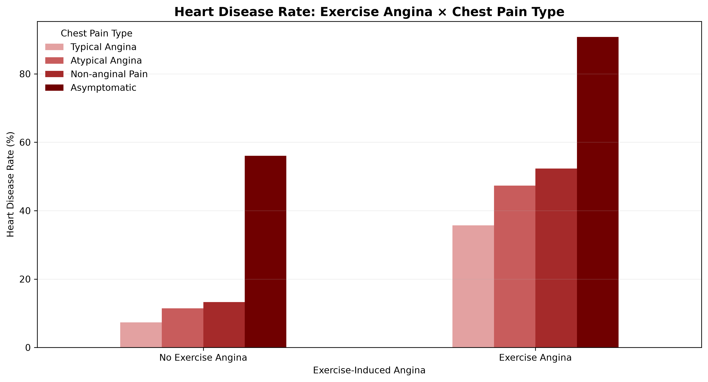

### Fasting Blood Sugar and ST Slope

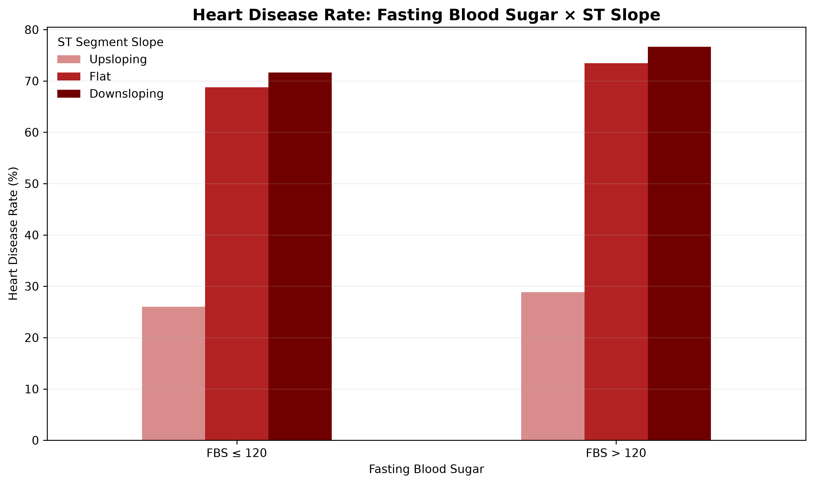

### Sex and Exercise Angina

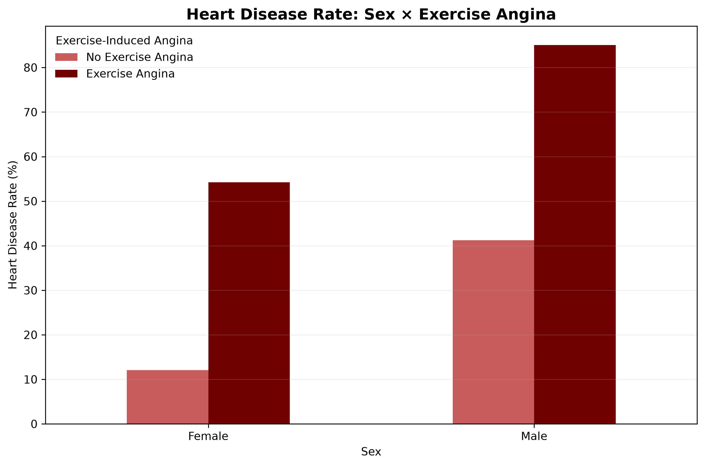

## Machine Learning Approach

### 1. Data Preparation

The preprocessing workflow includes:

- Removal of the record identifier from predictive features
- Binary target encoding
- Standardization of continuous features
- One-hot encoding of categorical features
- Stratified data splitting
- Scikit-learn pipelines to ensure preprocessing is fitted on the appropriate training data

### 2. Model Benchmarking

Six classification algorithms were evaluated:

| Model | Validation accuracy |
|---|---:|
| **XGBoost** | **89.01%** |
| CatBoost | 89.00% |
| LightGBM | 88.99% |
| HistGradientBoosting | 88.97% |
| Logistic Regression | 88.74% |
| Random Forest | 88.12% |

XGBoost achieved the highest observed validation accuracy in the benchmark.

The differences among the leading boosting models were small, making additional experiments important before selecting the final approach.

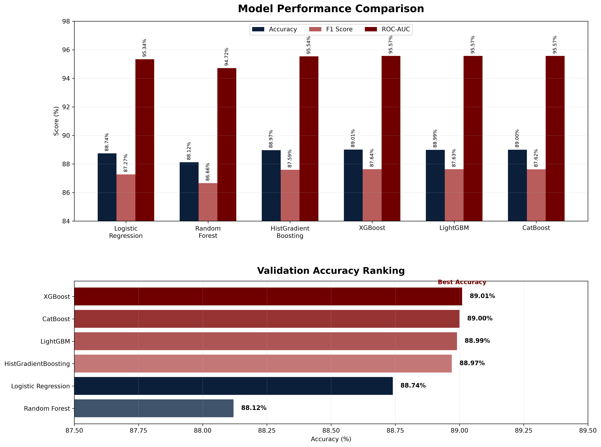

### 3. Baseline Model Evaluation

Logistic Regression was used as an initial benchmark before evaluating more complex ensemble and boosting algorithms.

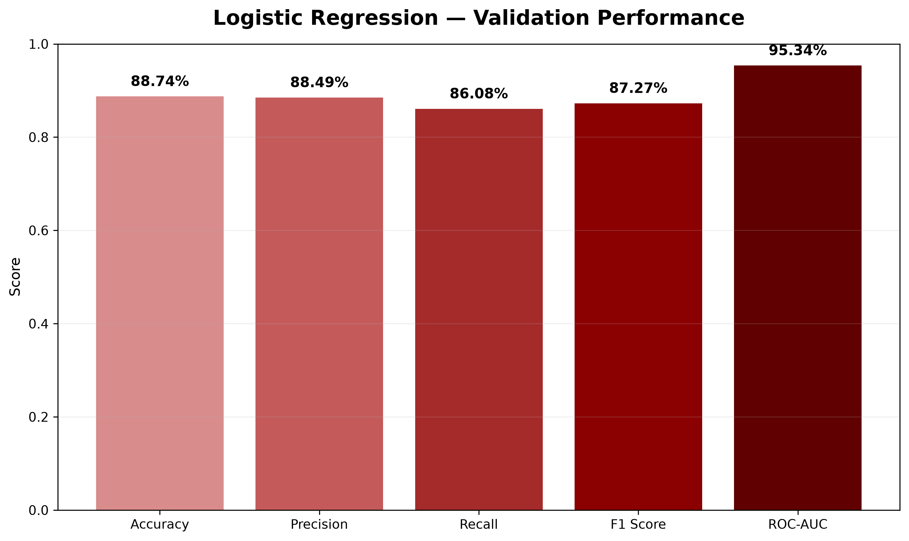

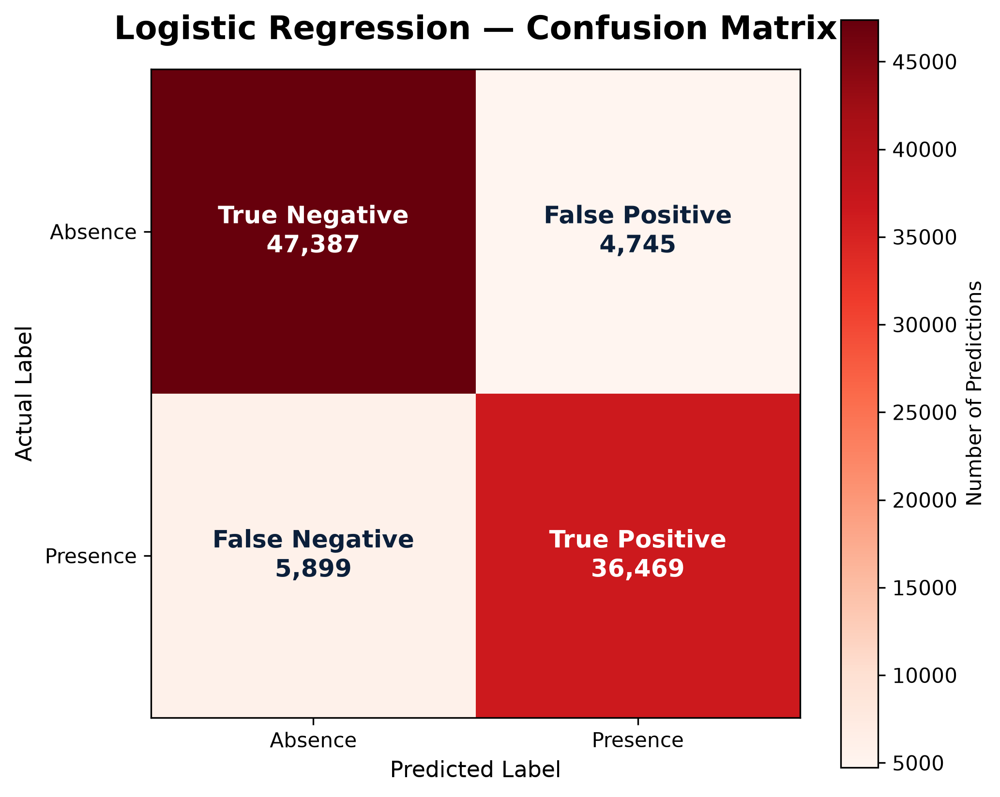

### 4. Optimization and Advanced Experiments

HeartAI investigates several approaches beyond basic model training.

**Hyperparameter optimization:** Optuna was used to explore 30 XGBoost configurations, including learning rate, tree depth, regularization, sampling ratios, and number of estimators.

**Feature engineering:** Additional interaction features were evaluated, including age × maximum heart rate, ST depression × exercise angina, and categorical feature combinations.

**Native categorical learning:** CatBoost was evaluated with its native categorical feature handling.

**Stratified cross-validation:** Three-fold cross-validation was used to examine model performance stability.

**Stacking ensemble:** XGBoost, LightGBM, and Logistic Regression were combined using out-of-fold predictions and a Logistic Regression meta-learner.

**Decision threshold analysis:** Validation predictions were evaluated across multiple probability thresholds to study accuracy, recall, and F1 trade-offs.

These experiments did not demonstrate a sufficiently compelling improvement over the original XGBoost configuration, so the simpler selected model was retained.

## Final Model Performance

The final XGBoost pipeline was fitted on the combined training and validation data, then evaluated on the held-out test partition.

| Metric | Final test result |
|---|---:|
| **ROC-AUC** | **95.51%** |
| Accuracy | 88.85% |
| Precision | 88.18% |
| Recall | 86.75% |
| F1 score | 87.46% |
| Average precision | 94.82% |

The ROC-AUC measures the model's ability to rank positive cases above negative cases across classification thresholds. Accuracy measures the proportion of correct classifications at the selected threshold of **0.50**.

### ROC Curve

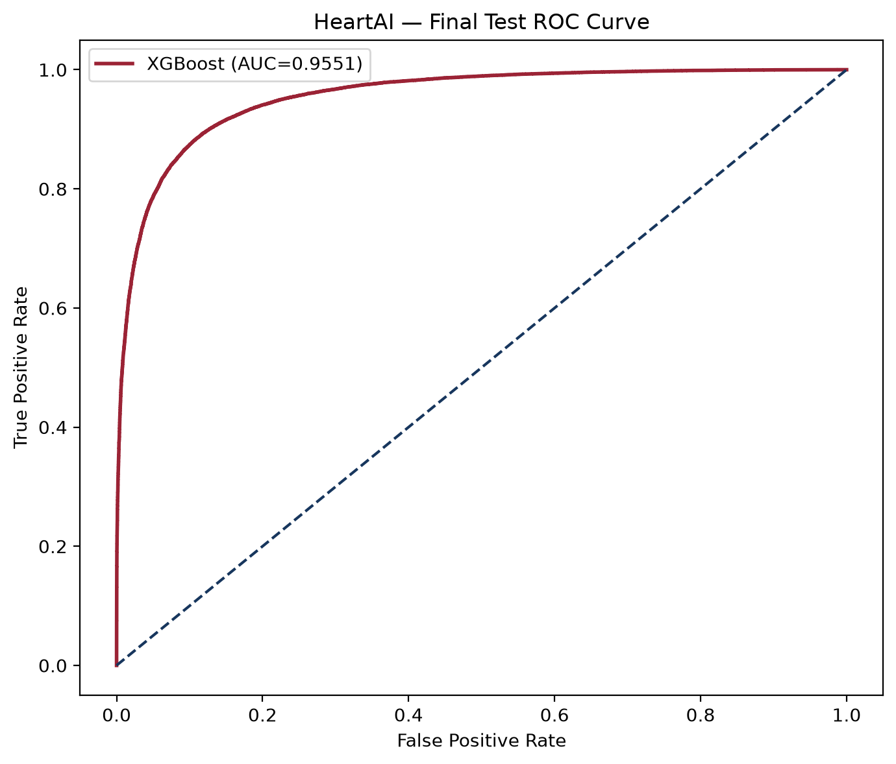

### Confusion Matrix

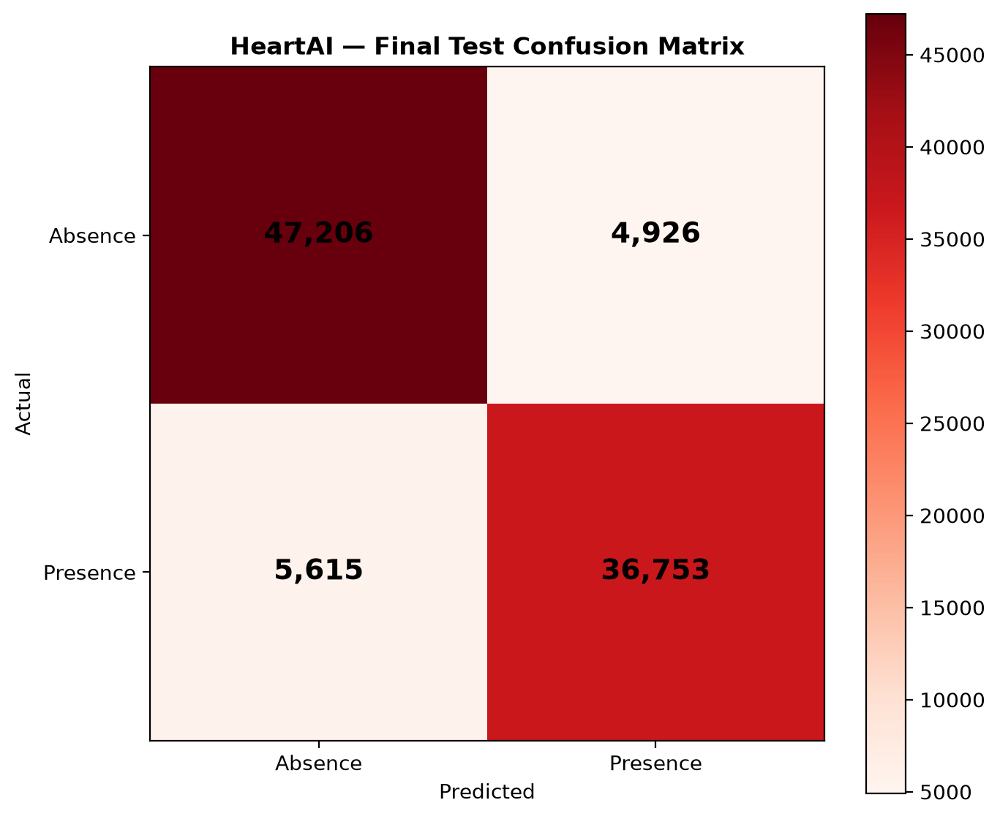

### Precision-Recall Curve

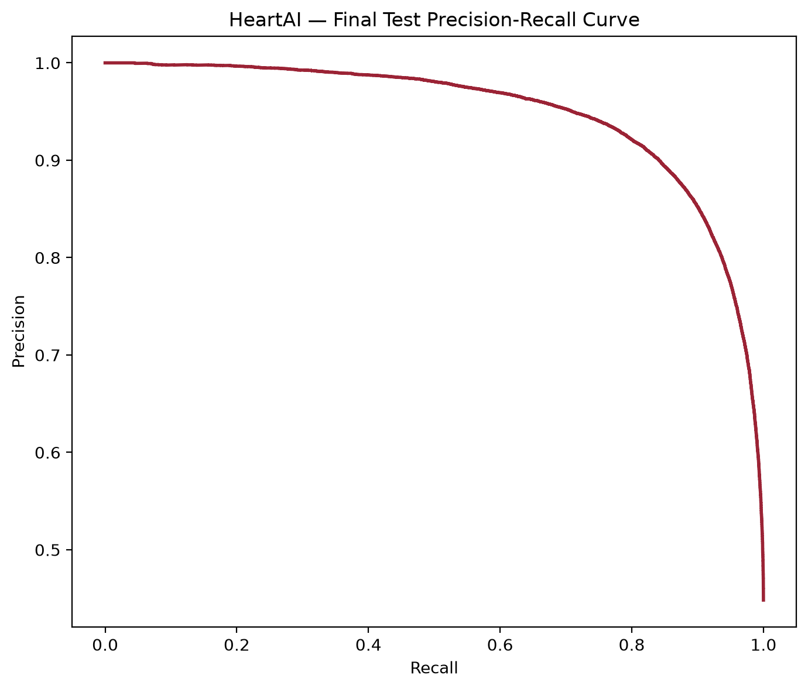

## Explainable AI with SHAP

Model interpretability is a central part of HeartAI.

SHAP (SHapley Additive exPlanations) is used to examine how input features contribute to the XGBoost model's predictions.

The explainability analysis uses a reproducible sample of **1,000 training records** and evaluates the model's **28 encoded features**.

### Global Feature Importance

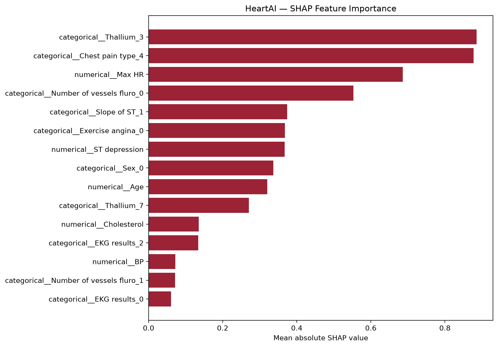

The most influential encoded features include:

- Thallium categories
- Chest pain type categories
- Maximum heart rate
- Number of major vessels
- ST slope categories
- Exercise-induced angina
- ST depression
- Age

These findings describe patterns learned by the model from synthetic data. They should not be interpreted as causal relationships or validated medical risk factors.

### SHAP Summary

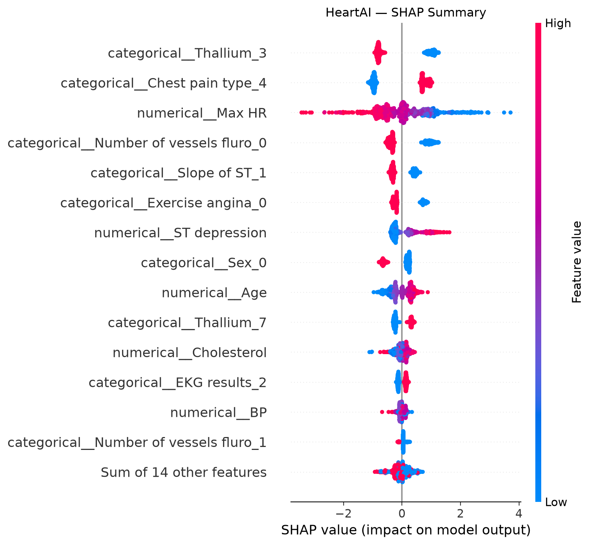

The beeswarm visualization illustrates the magnitude and direction of feature contributions across the sampled records.

### Individual Prediction Explanation

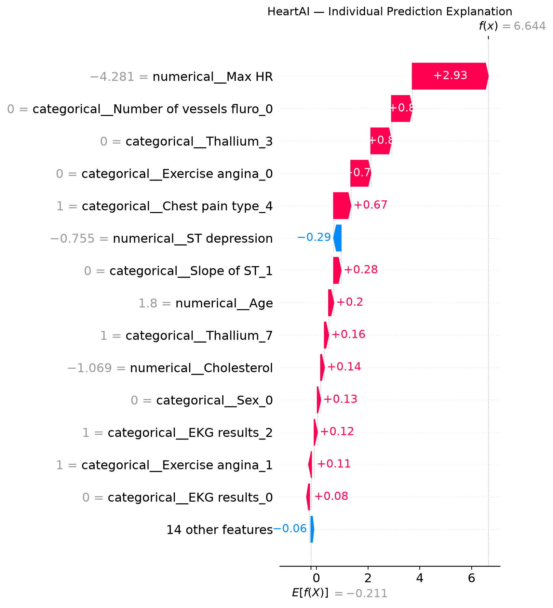

The waterfall visualization demonstrates how individual feature contributions combine to produce a model output for one example.

## Technology Stack

| Category | Technologies |
|---|---|
| Language | Python |
| Data analysis | pandas, NumPy |
| Machine learning | scikit-learn, XGBoost, LightGBM, CatBoost |
| Optimization | Optuna |
| Explainability | SHAP |
| Visualization | Matplotlib, Plotly |
| Model serialization | Joblib |
| Development | VS Code, Git, GitHub |

## Project Structure

```text
heart-disease-risk-prediction/
├── data/
│   └── raw/
├── models/
│   └── heartai_xgboost_pipeline.joblib
├── reports/
│   ├── figures/
│   ├── final_test_metrics.json
│   ├── final_test_predictions.csv
│   ├── shap_feature_importance.csv
│   ├── cross_validation_summary.csv
│   ├── stacking_comparison.csv
│   └── threshold_analysis.csv
├── src/
│   ├── preprocessing.py
│   ├── pipeline_test.py
│   ├── baseline_model.py
│   ├── model_comparison.py
│   ├── advanced_models.py
│   ├── tune_xgboost.py
│   ├── native_catboost.py
│   ├── feature_engineering.py
│   ├── cross_validation.py
│   ├── stacking_ensemble.py
│   ├── final_evaluation.py
│   ├── explainability.py
│   └── visualize_model_comparison.py
├── .gitignore
├── requirements.txt
└── README.md
```

## Installation and Reproduction

Clone the repository:

```bash
git clone <repository-url>
cd heart-disease-risk-prediction
```

Create a virtual environment:

```bash
python -m venv .venv
```

Activate it on Windows PowerShell:

```powershell
.\.venv\Scripts\Activate.ps1
```

Install dependencies:

```bash
python -m pip install -r requirements.txt
```

Download the training dataset from the [Kaggle Playground Series S6E2 competition](https://www.kaggle.com/competitions/playground-series-s6e2) and place `train.csv` in `data/raw/`.

Run the preprocessing checks:

```bash
python src/pipeline_test.py
```

Reproduce the model comparison:

```bash
python src/model_comparison.py
python src/advanced_models.py
```

Run cross-validation:

```bash
python src/cross_validation.py
```

Regenerate final evaluation reports using the previously trained model:

```bash
python src/final_evaluation.py
```

Generate SHAP explanations:

```bash
python src/explainability.py
```

**Reproducibility note:** The final evaluation and SHAP scripts require the trained model artifact. The repository does not currently include a dedicated final-model training script, so reproducing final model training from scratch requires following the documented model configuration and train/validation combination.


## Future Development

Planned extensions include an interactive Streamlit interface for exploring model predictions, probability outputs, performance visualizations, and explainability results.

Any interactive predictions will be clearly labeled as synthetic-data demonstrations rather than clinical risk estimates.


